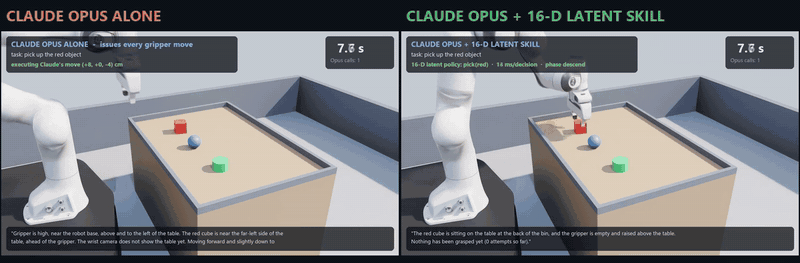
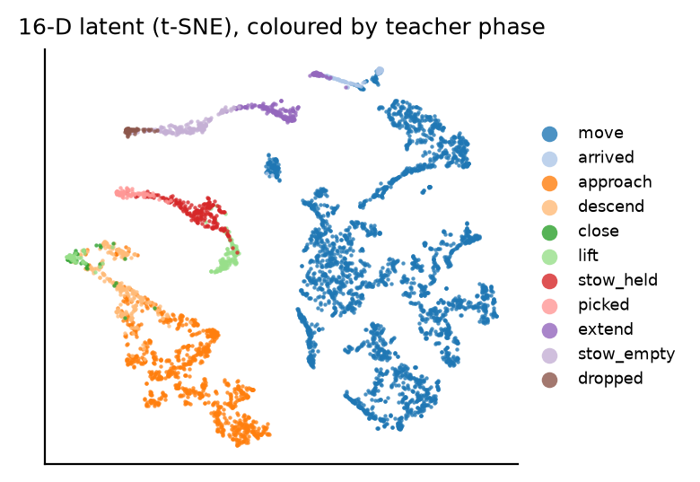
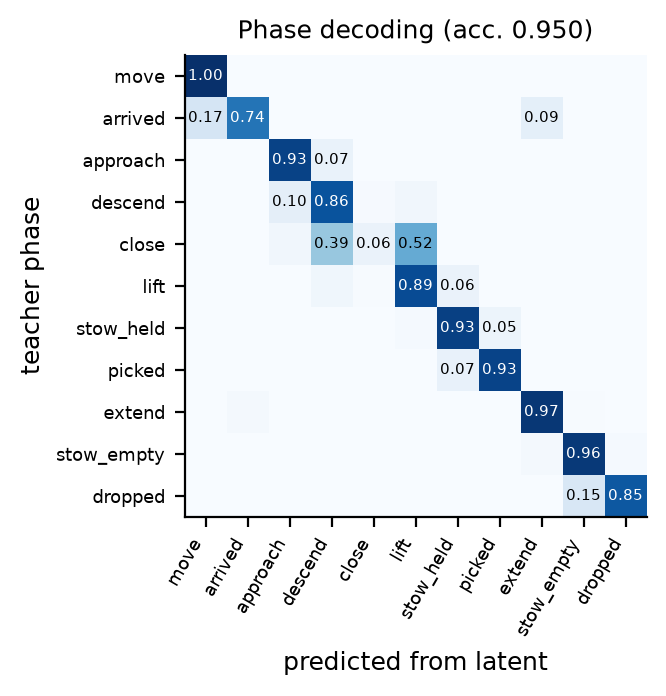
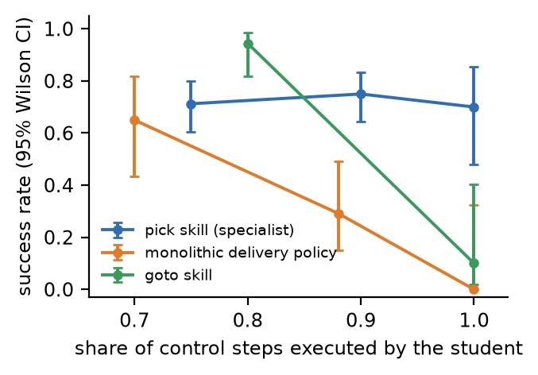
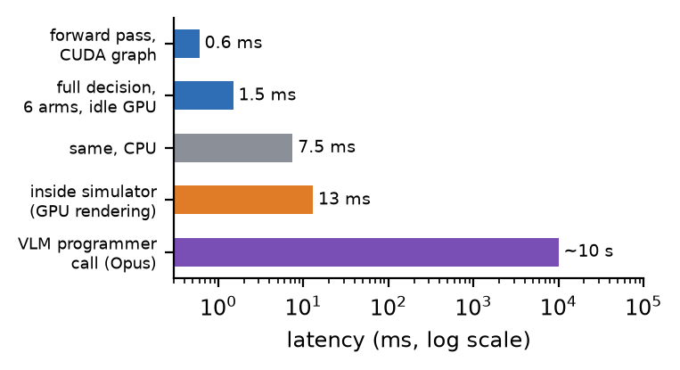
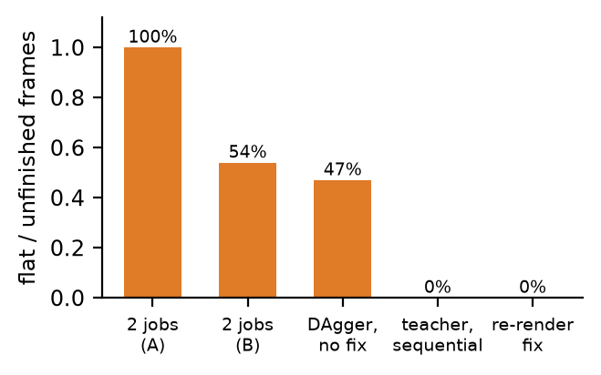

<div align="center">

<p align="center">
  
</p>

<p align="center">
  
  
</p>

**A large model decides what to do. Sixteen learned numbers decide how to move.**

Tribbie gives a vision-language model (Claude Opus) a robot it can actually operate.
Camera-only latent policies of 255k parameters run each skill at 15&nbsp;Hz;
Opus writes the program, calls the skills, checks the result from images and retries.
Everything runs in NVIDIA Isaac Sim with PhysX, and every number below is measured, not scripted.


</div>

> **Status.** Research prototype, simulation only. One mobile manipulator, one arena, three
> objects, two learned skills (pick, drop). Evaluations are small (6&ndash;20 trials per
> condition). The results show the size of the effects, not precise rates; see
> [Limitations](#limitations). The paper, slides and report are in [`paper/`](paper/),
> [`slides/`](slides/) and [`report/`](report/).

---

## Contents

- [The result](#the-result)
- [How it works](#how-it-works)
- [Three roles](#three-roles)
- [The 16-D latent](#the-16-d-latent)
- [What we measured](#what-we-measured)
- [The cameras lied first](#the-cameras-lied-first)
- [Quickstart](#quickstart)
- [Repository layout](#repository-layout)
- [Limitations](#limitations)
- [Next step: one Opus](#next-step-one-opus)
- [Name / inspiration](#name--inspiration)
- [Citation](#citation) · [License](#license)

---

## The result

Same robot, same two cameras, same instruction (&ldquo;pick up the red/green/blue object&rdquo;),
same Opus model and per-call time limit. Success is read from PhysX: the commanded object
between the fingers and at least 5&nbsp;cm above the table. Clocks are wall time,
including Opus thinking.

<p align="center">
  
</p>

<p align="center">
  
  
</p>

- **Opus alone** returns a gripper move of at most 8&nbsp;cm and open/close on each call.
  It reasons sensibly (&ldquo;faint blob at the top of the wrist image, move forward a bit&rdquo;),
  but it sees and acts once every ~10&nbsp;s. It never completed a grasp.
- **Opus + 16-D skill** returns `pick(colour)`; the latent policy closes the loop from pixels
  every 67&nbsp;ms. Both misses were the blue ball rolling away during the grasp.

The gap is bandwidth, not intelligence. Full video (56&nbsp;s, 30&nbsp;fps):
[`media/claude_vs_claude_plus_16d.mp4`](media/claude_vs_claude_plus_16d.mp4).

## How it works

<p align="center">
  
  
</p>

| Layer | What it is | Speed |
|---|---|---|
| **Operator** | Claude Opus through `claude -p` with a JSON schema. Reads up to four camera views and an execution log; returns an observation, an assessment and a program of `face / goto / pick / drop`. | ~10&nbsp;s per call |
| **Latent skills** | `pick(colour)`, `drop()`: gripper velocity in the arm frame + grip, from two small RGB cameras. Each reports its own phase, so the operator knows when it finished or stalled. | 15&nbsp;Hz, 1.5&nbsp;ms per decision |
| **Fixed controllers** | `face(heading)`, a grid path planner for `goto`, wrist-angle hold, inverse kinematics. Rotation is never a learned output. | 15&nbsp;Hz |

The robot is a Clearpath Ridgeback base with a Franka Panda arm. Grasps are friction only:
no welds, no teleporting.

## Three roles

| Role | Who | Job |
|---|---|---|
| **Teacher** | scripted controller | Reads exact object poses from the simulator. Demonstrates each task and labels the student's mistakes during DAgger. Training only; never acts in a reported run. |
| **Student** | the 16-D latent policy | Learns to copy the teacher from two camera images alone, without the poses. Becomes the `pick` and `drop` skills. |
| **Operator** | Claude Opus | Calls the trained skills, looks at the cameras, checks outcomes, retries. Never sees the teacher or the training data. |

Teacher &rarr; student is imitation learning; student &rarr; operator is a function call.
The teacher can cheat because the simulator knows where everything is; the student has to learn
the same behaviour from pixels, which is what a real robot would have.

## The 16-D latent

```text
head  RGB 96×96 ×2 ─▶ CNN + keypoints ─┐
                                       ├─▶ z ∈ ℝ¹⁶ ─┬─▶ gate + 4 experts ─▶ next 4 actions
wrist RGB 64×64 ×2 ─▶ CNN + keypoints ─┘            │           ▲          base v · gripper v · grip
                                                    │    joints · gripper · skill
                                                    └─▶ phase head: approach … lift … done
```

- **255,249 parameters**, two-thirds in the experts. A CUDA graph brings a decision for six
  arms from 7.2&nbsp;ms to 1.5&nbsp;ms; it runs in 7.5&nbsp;ms on a CPU.
- **Not PCA.** PCA keeps the directions in which pixels vary most, whatever causes them.
  The encoder here is trained jointly with the action, so its 16 numbers keep what is needed
  to act (where the object is relative to the fingers, whether it is held, which stage the
  task is in) and drop the rest.
- **Training:** behaviour cloning on teacher episodes with DART action noise, then DAgger
  rounds in which the student drives and the teacher relabels every visited state.

Nobody told the latent what the task stages are, yet they arrange themselves in order, and a
linear readout recovers the teacher's phase on 92.5&nbsp;±&nbsp;1.1&nbsp;% of held-out frames
(three seeds). The experts specialise on their own: 62&nbsp;% of `pick` on one expert,
66&nbsp;% of `drop` on another.

<p align="center">
  
  
</p>

## What we measured

| Experiment | Result |
|---|---|
| Camera-only pick, no teacher help | **14/20** |
| Learned drop | **28/28** |
| Full deliveries (learned pick + drop, planner `goto`) | **4/8** |
| End-to-end monolithic delivery policy, alone | **0** |
| Learned `goto`: with teacher help / alone | 34/36 / 1/10 (replaced by a planner) |
| Opus locating objects from images vs PhysX: 3 views / overview only | **83&nbsp;%** / 53&nbsp;% |
| Opus definite answers that were correct | 60/61 (errors are &ldquo;not visible&rdquo; abstentions) |

Ablations (held-out phase accuracy, three seeds):

| Variant | Phase accuracy |
|---|---|
| Both cameras, 16-D | 92.5 ± 1.1&nbsp;% |
| Head camera only, 16-D | 82.5 ± 1.9&nbsp;% |
| Wrist camera only, 16-D | 93.5 ± 2.0&nbsp;% |
| Both cameras, 4-D | 85.3 ± 1.0&nbsp;% |
| Both cameras, 64-D | 97.0 ± 0.5&nbsp;% |

The wrist camera carries most of the information; 4 numbers are too few; 64 help slightly.

<p align="center">
  
  
</p>

## The cameras lied first

Three rendering faults each looked like a modelling failure until the raw frames were inspected:

1. **~1&nbsp;m near clip.** The default clipping plane hid the table, the floor and the robot's
   own arm from its cameras.
2. **Unfinished frames.** Two simulators on one GPU produced 100&nbsp;% / 54&nbsp;% flat,
   sky-only frames, and 47&nbsp;% in one DAgger round.
3. **Black cameras.** 120 pick episodes with a black wrist camera were silently dropped by the
   training filter.

Fixes: one simulator at a time, re-render any frame whose pixel standard deviation is below 10,
filter black frames, set clipping explicitly. Check the cameras before blaming the model.

<p align="center">
  
</p>

## Quickstart

Requires Windows, an NVIDIA GPU, Isaac Sim 5.1 at `C:\isaacsim`, and the
[Claude Code CLI](https://docs.anthropic.com/en/docs/claude-code) for the operator.
Run one simulator at a time.

```powershell
# environment (Isaac Kit Python 3.11 + CUDA PyTorch)
powershell -ExecutionPolicy Bypass -File scripts\setup.ps1

# evaluate the shipped skills: learned pick + drop, planner goto
C:\isaacsim\python.bat src\course\run_skills.py --mode student --goto-planner `
    --checkpoint models\skills_s2.pt --checkpoint-pick models\skills_p3.pt --episodes 4 --deliveries 2

# Opus as operator
C:\isaacsim\python.bat src\course\run_opus_skills.py --goto-planner `
    --checkpoint models\skills_s2.pt --checkpoint-pick models\skills_p3.pt `
    --instruction "Put the blue ball in the teal bin." --frames artifacts\live_frames

# the head-to-head experiment (6 + 6 trials, ~20 min)
bash scripts/h2h.sh
```

Train from scratch:

```powershell
C:\isaacsim\python.bat src\course\run_skills.py --mode expert --noise 0.3 --episodes 40 --save-data data\skills\expert
.venv\Scripts\python.exe src\lm\train_bc.py --task skills --data data\skills\expert --out models\skills_s1.pt
C:\isaacsim\python.bat src\course\run_skills.py --mode dagger --beta 0.3 --checkpoint models\skills_s1.pt --save-data data\skills\dagger1
```

Figures, ablations and documents:

```powershell
.venv\Scripts\python.exe src\analysis\vision_figures.py
.venv\Scripts\python.exe src\analysis\result_figures.py
bash scripts/ablations.sh; bash scripts/ablations_seeds.sh
.venv\Scripts\python.exe paper\build_paper.py
.venv\Scripts\python.exe report\build_report.py
.venv\Scripts\python.exe scripts\make_readme_assets.py
```

## Repository layout

```text
src/
  course/      mobile-manipulation cell, skills, teacher, Opus operator, head-to-head runner
  lm/          latent MoE policy, behaviour cloning / DAgger trainer, CUDA-graph runtime
  sim/         Isaac Sim helpers and the fixed IK actuation layer
  relay/       six-arm relay cell
  analysis/    latent t-SNE, keypoints, gate usage, VLM verification, figures
  tools/       video encoding and the comparison cut
  *.py         earlier single-robot studies (see docs/legacy_pillar_study.md)
scripts/       pipelines: data collection, DAgger rounds, ablations, head-to-head, assets
models/        skills_p3.pt (pick), skills_s2.pt (drop / goto) and the ablation checkpoints
results/       every JSON behind the numbers above
paper/         six-page paper (HTML source → PDF) and figures
slides/        19-slide deck generator (pptxgenjs) and the built .pptx
report/        project report (HTML source → PDF)
media/         head-to-head comparison video
docs/          design notes, demos, earlier studies
```

Raw frames, datasets and full-length recordings are regenerable and not tracked.

## Limitations

- Simulation only, with Isaac's holonomic base model rather than wheel friction.
- One arena, three objects in nearly fixed slots: a narrow distribution, not general grasping.
- Small evaluations (6&ndash;20 trials per condition), so wide confidence intervals.
- Driving in the final system is a path planner, not a learned policy.
- Ablations are offline only.
- The operator's prompt states the arena layout and the `pick → face → goto → drop` recipe.
  Opus chooses objects, order, verification and retries; it does not discover the layout.

The approach fits fixed, structured settings now (factory cells, warehouses, lab automation):
a new skill costs a few hours, almost all of it simulator time. The open world needs varied
scenes, learned navigation, memory or a world model, sim-to-real transfer and probably a larger
latent.

## Next step: one Opus

Today two separate Opus roles built and ran this: an **engineer** (a coding assistant that wrote
the teacher, simulator and training code with the author) and an **operator** (calling skills at
run time). Merging them gives a loop in which the model builds its own fast skills, then uses them:

```text
describe task ─▶ Opus writes the teacher ─▶ collect demos ─▶ train 16-D student
              ─▶ verify against physics ─▶ add to toolbox ─▶ operate
```

Every stage exists here except the automatic one. Writing working teachers took several
iterations and human corrections, and the camera faults above were only found by inspecting
raw frames, so a merged system needs those checks built in and a human approving each new skill.
Exposing the latent and phase signals to the operator, not just skill names, is the open
interface question.

## Name / inspiration

Named after **Tribbie** from *Honkai: Star Rail*: one being across three small bodies. Here it is
one task across three roles (teacher, student, operator), and a large mind working through
small, fast hands. The character art in `assets/tribbie.png` is HoYoverse's, used as a fan icon.

## Citation

```bibtex
@misc{tribbie2026,
  title  = {Tribbie: compact latent visual skills as a fast control layer for a vision-language operator},
  author = {arahe-dev},
  year   = {2026},
  url    = {https://github.com/arahe-dev/tribbie}
}
```

Built with [Claude Code](https://claude.com/claude-code) as a coding assistant.

## License

Apache-2.0. See [LICENSE](LICENSE). The character art is not covered by this license.
